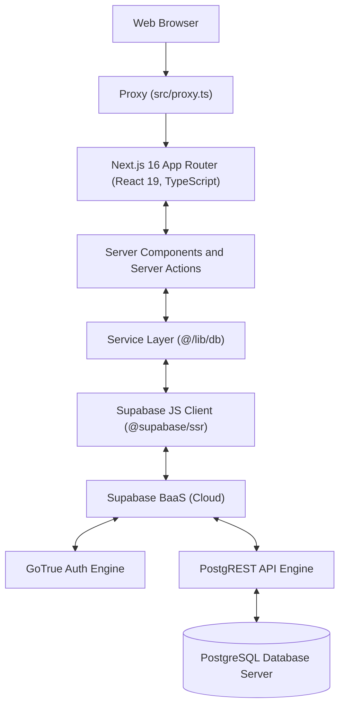
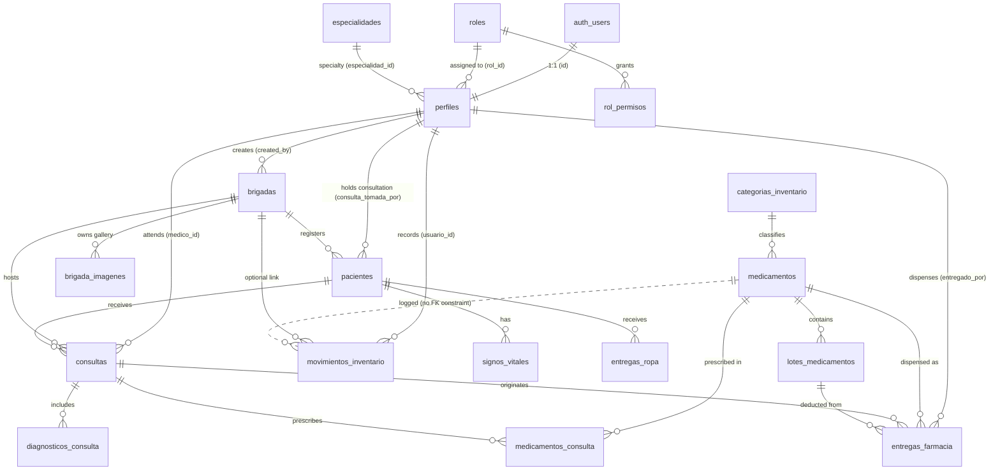
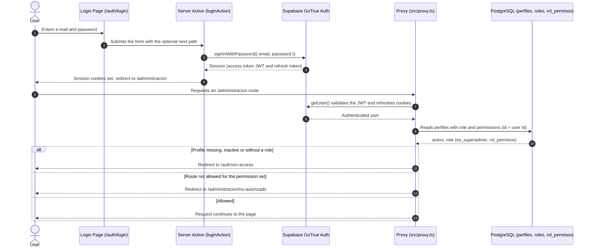
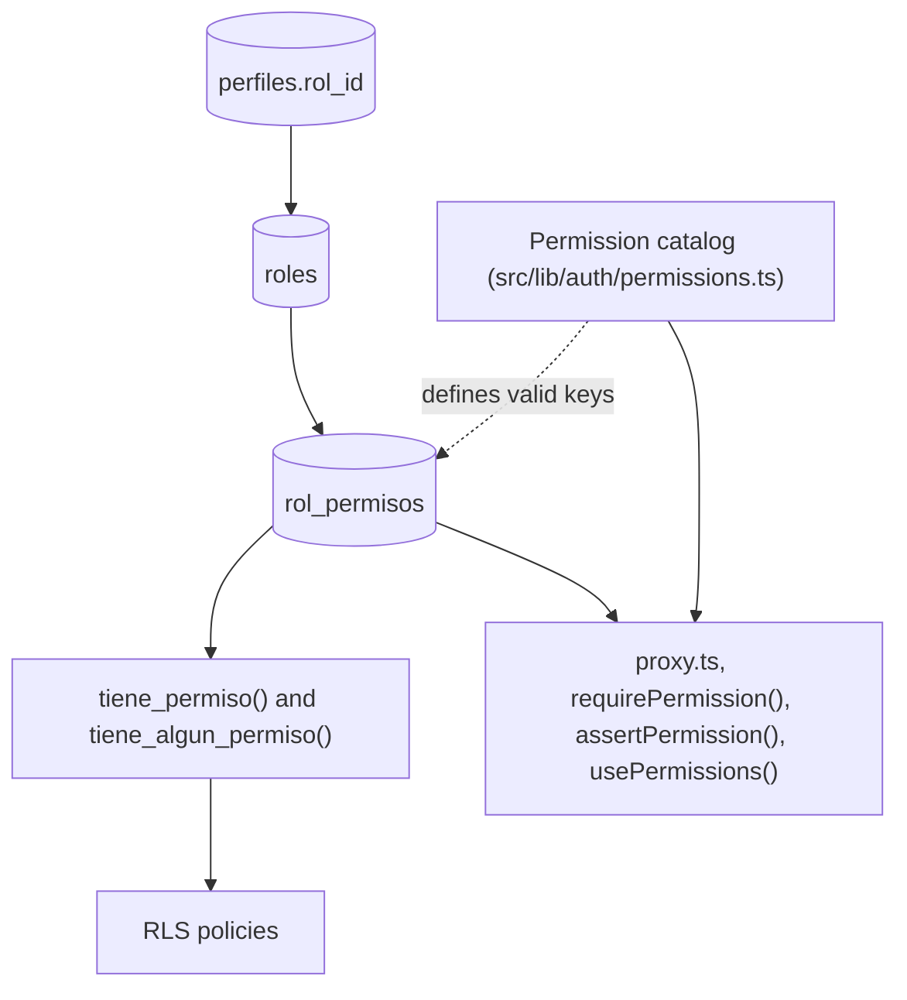
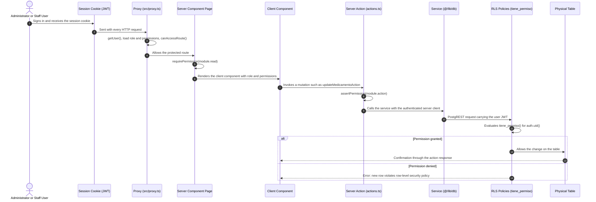
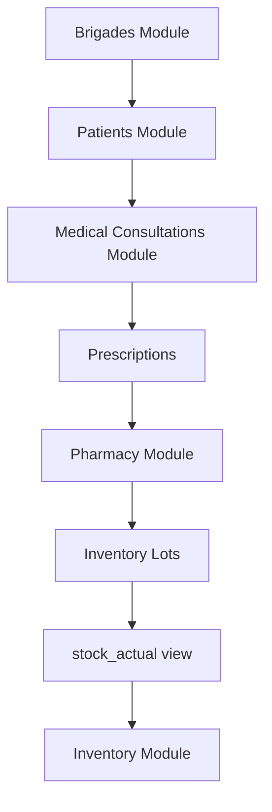
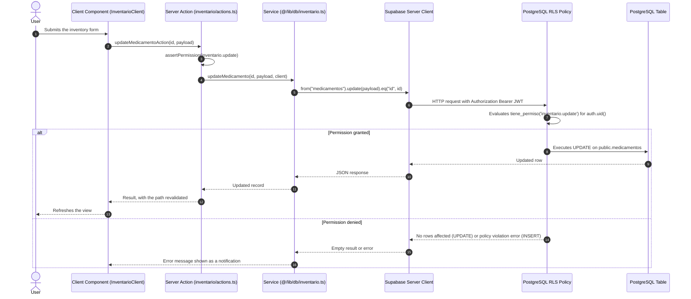

# System Architecture: Official Technical Documentation

> **Project:** Integrated Management System, Dibujando Sonrisas Foundation (Fundación Dibujando Sonrisas)  
> **Document version:** 1.5.0 (official development reference)  
> **Issue date:** July 2026 (last revised October 2026)  
> **Status:** Master document covering architecture, component inventory, CRUD matrix, authorization analysis and the RBAC model

---

## Table of Contents

1. [Project Overview](#1-project-overview)
2. [Database Architecture and Field Schema](#2-database-architecture-and-field-schema)
3. [SQL Function Definitions](#3-sql-function-definitions)
4. [Stored Trigger Definitions](#4-stored-trigger-definitions)
5. [Relational View Definitions](#5-relational-view-definitions)
6. [Row-Level Security (RLS) Policies](#6-row-level-security-rls-policies)
7. [Authentication System](#7-authentication-system)
8. [Role and Authorization System](#8-role-and-authorization-system)
9. [Frontend Architecture and Navigation Map](#9-frontend-architecture-and-navigation-map)
10. [Frontend Component Inventory](#10-frontend-component-inventory)
11. [Service and Backend Function Inventory](#11-service-and-backend-function-inventory)
12. [CRUD Technical Matrix](#12-crud-technical-matrix)
13. [Current Permission Inventory by Module](#13-current-permission-inventory-by-module)
14. [Protected Route Inventory](#14-protected-route-inventory)
15. [Authorization Dependency Diagram](#15-authorization-dependency-diagram)
16. [System Modules](#16-system-modules)
17. [Critical Dependencies and Module Interaction](#17-critical-dependencies-and-module-interaction)
18. [Global Data Flow](#18-global-data-flow)
19. [Project Technical Inventory](#19-project-technical-inventory)
20. [Detected Architecture Issues](#20-detected-architecture-issues)
21. [Role System Redesign (Phase 2)](#21-role-system-redesign-phase-2)
22. [Authorization Model](#22-authorization-model)

> **Conventions.** Database objects, route paths, permission keys and source file names are quoted exactly as they exist in the codebase, which uses Spanish identifiers (for example `brigadas`, `perfiles`, `tiene_permiso()`). The prose is in English, with a gloss where a name is not self-explanatory. The schema described here corresponds to the migrations up to `20261011235000_registros_offline_conflictos.sql`.

---

## 1. Project Overview

### 1.1 System Purpose

The system centralizes, automates and audits the technical, medical and logistical operations of the **Foundation**. It supports community medical brigades, inventory control of medicines and medical supplies, clinical patient care (medical and dental records), pharmacy dispensing, clothing donations, volunteer management, children's activities, support sales and management-level statistical reporting.

### 1.2 Technology Stack



- **Frontend:** Next.js 16 (App Router), React 19, TypeScript, plain CSS (design tokens in `src/styles/globals.css` plus CSS Modules) and `lucide-react` icons.
- **Request interception:** Next.js Proxy (`src/proxy.ts`), the Next.js 16 name for the convention formerly called Middleware. It refreshes the session and authorizes `/administracion` routes.
- **Backend / BaaS:** Supabase: PostgreSQL, GoTrue authentication, PostgREST API, Storage (bucket `brigadas` for brigade photos) and Realtime (live notifications).
- **Authentication:** Supabase Auth (JWT) with HTTP cookie sessions managed through `@supabase/ssr`.
- **Validation:** Zod.
- **Transactional e-mail:** Resend REST API (`RESEND_API_KEY`), used for contact, volunteer and new-user notices and for password links.
- **Data typing:** static TypeScript types generated from the PostgreSQL schema (`src/lib/database.types.ts`).
- **Supabase clients:** `src/lib/supabase.ts` (browser client, one per tab), `src/lib/supabase-server.ts` (server client bound to the request cookies, used by Server Components and Server Actions; one per request through React `cache`, never shared between users) and `src/lib/supabase-admin.ts` (service key, server only, one per process, bypasses RLS and is used only after permissions have been verified). All three talk to Supabase over HTTP, so there are no database connections to close; Realtime channels are removed when the subscribing component unmounts.
- **Logging:** LogTape through `src/lib/logger.ts`, configured in `src/instrumentation.ts` (server, logfmt, also logs unhandled request errors) and `src/instrumentation-client.ts` (browser). `scripts/offline.mjs` writes its own logfmt trace.
- **Offline mode:** a brigade-side deployment (`npm run offline`, `NEXT_PUBLIC_MODO_OFFLINE=1`) runs the application against a local Supabase instance. Changes are synchronized back with `scripts/offline.mjs` and audited in the table `registros_offline`.

**Cross-references:** See also: [Chapter 7 (Authentication)](#7-authentication-system) | [Chapter 9 (Frontend)](#9-frontend-architecture-and-navigation-map) | [Chapter 11 (Backend Services)](#11-service-and-backend-function-inventory)

---

## 2. Database Architecture and Field Schema

### 2.1 Entity-Relationship Diagram (ERD)



The relationship between `medicamentos` and `movimientos_inventario` is logical only: the schema declares no foreign key on `movimientos_inventario.medicamento_id` (see [Chapter 20](#20-detected-architecture-issues)).

### 2.2 Field Dictionary for Core Tables

This section documents the tables at the core of the clinical, inventory, brigade and authorization workflows. The remaining tables are catalogued in [Section 2.3](#23-catalogue-of-remaining-tables). All tables have row-level security enabled.

#### 1. `public.perfiles`
Extended profile of every authenticated user (administrative staff, clinicians and volunteers). The e-mail address is stored in `auth.users`, not in this table.
- **`id`** (`uuid`, primary key, foreign key to `auth.users.id` ON DELETE CASCADE, NOT NULL): user identifier.
- **`nombre_completo`** (`text`, NOT NULL, CHECK length between 5 and 120): full name.
- **`telefono`** (`text`, NULL): phone number.
- **`cargo`** (`text`, NULL): job title.
- **`rol_id`** (`uuid`, foreign key to `public.roles.id` ON DELETE RESTRICT, NOT NULL, default `rol_predeterminado_id()`): assigned role. It replaces the former `rol` enum column.
- **`activo`** (`boolean`, NOT NULL, default `true`): account state. Inactive users cannot use the administrative panel.
- **`avatar_url`** (`text`, NULL): profile picture URL.
- **`fecha_nacimiento`** (`date`, NULL): date of birth.
- **`sexo`** (`character(1)`, NULL, CHECK `IN ('M', 'F')`): sex.
- **`especialidad_id`** (`uuid`, foreign key to `public.especialidades.id`, NULL): professional specialty (for example general physician or dentist).
- **`created_at`** (`timestamptz`, NOT NULL, default `now()`): registration date.
- **`updated_at`** (`timestamptz`, NOT NULL, default `now()`): last update.

#### 2. `public.roles`
Roles managed from Users > Roles. The permissions of each role are stored in `public.rol_permisos`.
- **`id`** (`uuid`, primary key, default `gen_random_uuid()`, NOT NULL).
- **`nombre`** (`text`, NOT NULL, CHECK trimmed length between 2 and 60, unique case-insensitively): role name.
- **`descripcion`** (`text`, NULL, CHECK length up to 240): description.
- **`color`** (`text`, NOT NULL, default `'neutral'`, CHECK `IN ('brand', 'info', 'success', 'warning', 'danger', 'neutral')`): badge tone in the interface.
- **`es_superadmin`** (`boolean`, NOT NULL, default `false`): marks the administrator role, which holds every permission, including permissions added in the future. At most one role may carry this flag (partial unique index).
- **`es_predeterminado`** (`boolean`, NOT NULL, default `false`): marks the role assigned to new users. At most one role may carry this flag (partial unique index) and that role cannot be deleted.
- **`created_at`** (`timestamptz`, NOT NULL, default `now()`).
- **`updated_at`** (`timestamptz`, NOT NULL, default `now()`).

#### 3. `public.rol_permisos`
Permission keys granted to each role. The administrator role has no rows because it implicitly holds every permission.
- **`rol_id`** (`uuid`, foreign key to `public.roles.id` ON DELETE CASCADE, NOT NULL).
- **`permiso`** (`text`, NOT NULL, CHECK matches `^[a-z_]+\.[a-z_]+$`): permission key in `module.action` format (for example `inventario.read`). The list of valid keys lives in code (`src/lib/auth/permissions.ts`); the database only enforces the format.
- **Primary key:** (`rol_id`, `permiso`).

#### 4. `public.categorias_inventario`
Classification of pharmacy and supply resources. Each category belongs to one resource type.
- **`id`** (`uuid`, primary key, default `gen_random_uuid()`, NOT NULL).
- **`codigo`** (`character varying(10)`, UNIQUE, NOT NULL): alphanumeric identifier code.
- **`nombre`** (`character varying(100)`, NOT NULL): category name.
- **`descripcion`** (`text`, NULL): detailed description.
- **`activo`** (`boolean`, default `true`): state.
- **`tipo_recurso`** (`character varying(30)`, NOT NULL, CHECK `IN ('medicamento', 'insumo_medico', 'material_brigada')`): resource type served by the category. A name is unique within a resource type (unique index on `tipo_recurso, lower(nombre)`).
- **`created_at`** (`timestamptz`, default `now()`).
- **`updated_at`** (`timestamptz`, default `now()`).

#### 5. `public.medicamentos`
Physical catalogue of medicines, medical supplies and brigade materials.
- **`id`** (`uuid`, primary key, default `gen_random_uuid()`, NOT NULL).
- **`codigo`** (`character varying(20)`, UNIQUE, NOT NULL): short code or SKU.
- **`categoria_id`** (`uuid`, foreign key to `public.categorias_inventario.id`, NOT NULL).
- **`nombre`** (`character varying(150)`, NOT NULL): name of the drug or supply.
- **`descripcion`** (`text`, NULL): dosage, concentration or specifications.
- **`presentacion`** (`character varying(100)`, NULL): presentation form.
- **`unidad_medida`** (`character varying(30)`, NULL): unit of measure (bottles, tablets, boxes, tubes).
- **`stock_actual`** (`integer`, NOT NULL, default `0`, CHECK >= 0): cached stock quantity maintained by the triggers `trg_actualizar_stock` and `trg_recalcular_stock`. The `stock_actual` view does not read this column; it derives totals from lots.
- **`stock_minimo`** (`integer`, default `10`, CHECK >= 0): critical stock threshold.
- **`requiere_receta`** (`boolean`, default `false`): whether a prescription is required.
- **`activo`** (`boolean`, default `true`): state.
- **`tipo_recurso`** (`character varying(30)`, NOT NULL, default `'medicamento'`, CHECK `IN ('medicamento', 'insumo_medico', 'material_brigada')`).
- **`created_at`** (`timestamptz`, default `now()`).
- **`updated_at`** (`timestamptz`, default `now()`).

#### 6. `public.lotes_medicamentos`
Source of truth for stock, by lot number and expiry date.
- **`id`** (`uuid`, primary key, default `gen_random_uuid()`, NOT NULL).
- **`medicamento_id`** (`uuid`, foreign key to `public.medicamentos.id` ON DELETE CASCADE, NOT NULL).
- **`numero_lote`** (`character varying(50)`, NOT NULL): lot code assigned by the manufacturer or the system.
- **`fabricante`** (`character varying(150)`, NULL): pharmaceutical company or supplier.
- **`fecha_vencimiento`** (`date`, NOT NULL): expiry date.
- **`cantidad_actual`** (`integer`, NOT NULL, CHECK >= 0): quantity currently available.
- **`fecha_ingreso`** (`date`, default `CURRENT_DATE`): date the lot was received.
- **`observaciones`** (`text`, NULL).
- **`cantidad_inicial`** (`integer`, NULL, CHECK >= 0): quantity with which the lot was received. The application sets it equal to the initial `cantidad_actual` on creation.
- **`created_at`** (`timestamptz`, default `now()`).
- **`updated_at`** (`timestamptz`, default `now()`).

#### 7. `public.movimientos_inventario`
Ledger (kardex) of inventory transactions.
- **`id`** (`uuid`, primary key, default `gen_random_uuid()`, NOT NULL).
- **`medicamento_id`** (`uuid`, NOT NULL): affected resource. No foreign key constraint is declared.
- **`tipo`** (`character(1)`, NULL, CHECK `IN ('E', 'S', 'A')`): `E` entry, `S` exit, `A` adjustment (sets the stock to the quantity given).
- **`cantidad`** (`integer`, NOT NULL, CHECK > 0): quantity moved.
- **`motivo`** (`character varying(200)`, NULL): reason for the transaction.
- **`brigada_id`** (`uuid`, foreign key to `public.brigadas.id` ON DELETE CASCADE, NULL).
- **`usuario_id`** (`uuid`, foreign key to `public.perfiles.id`, NULL).
- **`fecha_movimiento`** (`timestamptz`, default `now()`).
- **`observaciones`** (`text`, NULL).

#### 8. `public.brigadas`
Logistical record of community health operations.
- **`id`** (`uuid`, primary key, default `gen_random_uuid()`, NOT NULL).
- **`codigo`** (`character varying(15)`, UNIQUE, NOT NULL): human-readable code in the format `BRG-YYYY-NNN`, generated by a trigger when not supplied.
- **`nombre`** (`character varying(150)`, NOT NULL, CHECK length >= 5).
- **`descripcion`** (`text`, NULL).
- **`lugar`** (`character varying(150)`, NOT NULL): venue.
- **`municipio`** (`character varying(100)`, NOT NULL).
- **`departamento`** (`character varying(100)`, NOT NULL).
- **`fecha_brigada`** (`date`, NOT NULL).
- **`fecha_inicio_inscripcion`** (`date`, NOT NULL): start of volunteer registration.
- **`fecha_fin_inscripcion`** (`date`, NOT NULL, CHECK >= `fecha_inicio_inscripcion`): end of volunteer registration.
- **`estado`** (`estado_brigada`, NOT NULL, default `'planificacion'`): one of `planificacion`, `inscripciones_abiertas`, `inscripciones_cerradas`, `en_preparacion`, `finalizada`, `cancelada`.
- **`capacidad_voluntarios`** (`integer`, NULL, CHECK > 0).
- **`imagen_banner`** (`text`, NULL).
- **`latitud`** (`numeric(9,6)`, NULL, CHECK between -90 and 90).
- **`longitud`** (`numeric(9,6)`, NULL, CHECK between -180 and 180).
- **`created_by`** (`uuid`, foreign key to `public.perfiles.id`, NULL).
- **`created_at`** (`timestamptz`, default `now()`).
- **`updated_at`** (`timestamptz`, default `now()`).

#### 9. `public.pacientes`
Unified patient file. A patient is registered in a brigade and advances through the record stages exposed by the view `v_pacientes_atendidos`.
- **`id`** (`uuid`, primary key, default `gen_random_uuid()`, NOT NULL).
- **`brigada_id`** (`uuid`, foreign key to `public.brigadas.id` ON DELETE CASCADE, NOT NULL).
- **`codigo`** (`character varying(20)`, UNIQUE, NOT NULL).
- **`nombres`** (`character varying(120)`, NOT NULL).
- **`apellidos`** (`character varying(120)`, NULL).
- **`sexo`** (`character varying(15)`, NULL, CHECK `IN ('Masculino', 'Femenino')`).
- **`fecha_nacimiento`** (`date`, NULL).
- **`edad`** (`integer`, NULL).
- **`telefono`** (`character varying(25)`, NULL).
- **`comunidad`** (`character varying(150)`, NULL).
- **`responsable`** (`character varying(150)`, NULL): guardian or responsible person.
- **`consulta_tomada_por`** (`uuid`, foreign key to `public.perfiles.id` ON DELETE SET NULL, NULL): user who has taken the patient's consultation. While it is set, the interface prevents anyone else from attending the patient.
- **`created_at`** (`timestamptz`, default `now()`).
- **`updated_at`** (`timestamptz`, default `now()`).

#### 10. `public.consultas`
Record of clinical attentions in medicine and dentistry.
- **`id`** (`uuid`, primary key, default `gen_random_uuid()`, NOT NULL).
- **`paciente_id`** (`uuid`, foreign key to `public.pacientes.id` ON DELETE CASCADE, NOT NULL).
- **`brigada_id`** (`uuid`, foreign key to `public.brigadas.id` ON DELETE CASCADE, NOT NULL).
- **`medico_id`** (`uuid`, foreign key to `public.perfiles.id`, NULL): attending professional.
- **`tipo_consulta`** (`character varying(20)`, NULL, CHECK `IN ('Medica', 'Odontologica')`).
- **`motivo_consulta`** (`text`, NULL): reason for the visit.
- **`enfermedad_actual`** (`text`, NULL): present illness.
- **`diagnostico`** (`text`, NULL).
- **`tratamiento`** (`text`, NULL).
- **`requiere_postclinica`** (`boolean`, default `false`).
- **`observaciones`** (`text`, NULL).
- **`created_at`** (`timestamptz`, default `now()`).

#### 11. `public.medicamentos_consulta`
Prescription lines of a consultation.
- **`id`** (`uuid`, primary key, default `gen_random_uuid()`, NOT NULL).
- **`consulta_id`** (`uuid`, foreign key to `public.consultas.id` ON DELETE CASCADE, NOT NULL).
- **`medicamento_id`** (`uuid`, foreign key to `public.medicamentos.id`, NOT NULL).
- **`cantidad`** (`integer`, NOT NULL): prescribed quantity.
- **`indicaciones`** (`text`, NULL): instructions for use.

#### 12. `public.entregas_farmacia`
History of physical dispensing at the pharmacy window.
- **`id`** (`uuid`, primary key, default `gen_random_uuid()`, NOT NULL).
- **`consulta_id`** (`uuid`, foreign key to `public.consultas.id` ON DELETE CASCADE, NOT NULL).
- **`medicamento_id`** (`uuid`, foreign key to `public.medicamentos.id`, NOT NULL).
- **`lote_id`** (`uuid`, foreign key to `public.lotes_medicamentos.id`, NOT NULL).
- **`cantidad`** (`integer`, NOT NULL, CHECK > 0).
- **`entregado_por`** (`uuid`, foreign key to `public.perfiles.id`, NULL): user who dispensed.
- **`fecha_entrega`** (`timestamptz`, default `now()`).
- **`observaciones`** (`text`, NULL).

### 2.3 Catalogue of Remaining Tables

| Table | Purpose |
|---|---|
| `especialidades` | Professional specialties of volunteers (`codigo` and `nombre` are unique). `tipo_consulta` (`Medica` or `Odontologica`) marks clinical specialties. Readable by anonymous users for the public volunteer form. |
| `inscripciones_voluntarios` | Volunteer requests from the public forms. `brigada_id` is NULL for general requests submitted from `/voluntariado`. `estado` is `pendiente`, `aceptado` or `rechazado`. An e-mail address or phone number can register only once per brigade and once as a general volunteer (unique indexes `uq_inscripciones_correo` and `uq_inscripciones_telefono`, with phone numbers compared through `normalizar_telefono()`). |
| `asignaciones_voluntarios` | Assignment of a volunteer profile to an area of a brigade (`area_asignada`, enum `area_voluntariado`). Unique per brigade and profile. |
| `participaciones_voluntarios` | Attendance records (`asistio`, `hora_llegada`, `hora_salida`), unique per brigade and profile. Written by `sp_confirmar_participacion()`. |
| `presupuestos_brigada` | Estimated budget of a brigade (one row per brigade). |
| `gastos_brigada` | Expenses of a brigade, classified by `categoria` (enum `categoria_gasto`). |
| `brigada_imagenes` | Metadata of the brigade photo gallery stored in the Storage bucket `brigadas` (`storage_path`, `orden`, `portada`). |
| `signos_vitales` | Vital signs captured in the pre-clinic stage of a patient record. |
| `diagnosticos_consulta` | One row per diagnosis of a consultation. |
| `donaciones_ropa` | Clothing donations received. |
| `entregas_ropa` | Clothing delivered to patients during a brigade (one or two garments per delivery). |
| `actividades_infantiles` | Children's activities held in a brigade, with the number of gifts distributed. |
| `participantes_actividad` | Number of children participating in an activity. |
| `categorias_productos` | Categories of products sold in support sales. |
| `productos` | Products for support sales, with price and stock. |
| `ventas` | Sales. `total` is maintained by a trigger. |
| `detalle_ventas` | Sale line items. Inserting a line decreases product stock through a trigger. |
| `contacto` | Messages submitted through the public contact form (`leido` marks messages already read). |
| `destinatarios_correo` | Recipients of each e-mail notice (primary key `aviso`, `perfil_id`). Notice keys come from `src/lib/avisosCorreo.ts`. |
| `notificaciones` | Notifications shown in the panel bell. Created only through `notificar()`. Each row carries the permission key required to view it and is retained for 60 days. |
| `notificaciones_vistas` | Per-user "seen until" timestamp used by the notification bell. |
| `registros_offline` | Audit trail of records created, changed or deleted on an offline brigade server, with synchronization conflicts. RLS is enabled with no policies, so it is reachable only with the service key. |
| `user_roles` | Legacy table (text role per user). Superseded by `perfiles.rol_id` and unused by the application. |
| `atenciones_pacientes` | Legacy table, unused by the application. |
| `voluntarios` | Legacy table of an earlier public volunteer form. No application code writes to it. |

**Cross-references:** See also: [Chapter 5 (Relational Views)](#5-relational-view-definitions) | [Chapter 12 (CRUD Matrix)](#12-crud-technical-matrix)

---

## 3. SQL Function Definitions

### 3.1 Authorization Functions

Authorization in the database is permission-based. The role-name helpers `get_user_role()`, `has_role()`, `has_any_role()`, `is_admin()`, `is_panel_user()` and `is_clinical()`, together with the `perfiles.rol` column and the `user_role` enum, were removed by the migration `20261002120000_roles_dinamicos.sql`.

The functions below are the authorization primitives used by every RLS policy. They are `SECURITY DEFINER` with an empty `search_path`, and the permission checks evaluate to true only for active users. Policies call them as `(SELECT public.tiene_permiso('x'))` so that PostgreSQL evaluates them once per query instead of once per row.

```sql
-- Default role assigned to new users
CREATE OR REPLACE FUNCTION public.rol_predeterminado_id() RETURNS uuid
  LANGUAGE sql STABLE SECURITY DEFINER
  SET search_path = ''
  AS $$
  SELECT id FROM public.roles WHERE es_predeterminado LIMIT 1;
$$;

-- True when the active user holds the given permission key.
-- Every active user holds 'perfil.read'; the superadmin role holds everything.
CREATE OR REPLACE FUNCTION public.tiene_permiso(p_permiso text) RETURNS boolean
  LANGUAGE sql STABLE SECURITY DEFINER
  SET search_path = ''
  AS $$
  SELECT EXISTS (
    SELECT 1
    FROM public.perfiles pf
    JOIN public.roles r ON r.id = pf.rol_id
    WHERE pf.id = (SELECT auth.uid())
      AND pf.activo
      AND (
        r.es_superadmin
        OR p_permiso = 'perfil.read'
        OR EXISTS (
          SELECT 1 FROM public.rol_permisos rp
          WHERE rp.rol_id = r.id AND rp.permiso = p_permiso
        )
      )
  );
$$;

-- True when the active user holds at least one of the given permission keys
CREATE OR REPLACE FUNCTION public.tiene_algun_permiso(p_permisos text[]) RETURNS boolean
  LANGUAGE sql STABLE SECURITY DEFINER
  SET search_path = ''
  AS $$
  SELECT EXISTS (
    SELECT 1
    FROM public.perfiles pf
    JOIN public.roles r ON r.id = pf.rol_id
    WHERE pf.id = (SELECT auth.uid())
      AND pf.activo
      AND (
        r.es_superadmin
        OR 'perfil.read' = ANY (p_permisos)
        OR EXISTS (
          SELECT 1 FROM public.rol_permisos rp
          WHERE rp.rol_id = r.id AND rp.permiso = ANY (p_permisos)
        )
      )
  );
$$;

-- Panel user: holds some permission besides their own profile
-- (replaces is_panel_user; allows reading the names of other profiles)
CREATE OR REPLACE FUNCTION public.es_usuario_panel() RETURNS boolean
  LANGUAGE sql STABLE SECURITY DEFINER
  SET search_path = ''
  AS $$
  SELECT EXISTS (
    SELECT 1
    FROM public.perfiles pf
    JOIN public.roles r ON r.id = pf.rol_id
    WHERE pf.id = (SELECT auth.uid())
      AND pf.activo
      AND (
        r.es_superadmin
        OR EXISTS (
          SELECT 1 FROM public.rol_permisos rp
          WHERE rp.rol_id = r.id AND rp.permiso NOT LIKE 'perfil.%'
        )
      )
  );
$$;

-- True when the active user holds the administrator (superadmin) role
CREATE OR REPLACE FUNCTION public.es_superadmin() RETURNS boolean
  LANGUAGE sql STABLE SECURITY DEFINER
  SET search_path = ''
  AS $$
  SELECT EXISTS (
    SELECT 1
    FROM public.perfiles pf
    JOIN public.roles r ON r.id = pf.rol_id
    WHERE pf.id = (SELECT auth.uid()) AND pf.activo AND r.es_superadmin
  );
$$;
```

### 3.2 Role Administration Functions

Both functions are `SECURITY INVOKER`: the RLS policies and guard triggers of [Chapter 4](#4-stored-trigger-definitions) apply to the calling user. They run in a single transaction and are executable only by authenticated users.

| Function | Behavior |
|---|---|
| `guardar_rol(p_id, p_nombre, p_descripcion, p_color, p_predeterminado, p_permisos)` | Creates a role (when `p_id` is NULL, requires `roles.create`) or updates one (requires `roles.update`) and leaves its permissions exactly equal to `p_permisos`. Changes the default role only by marking another role as default, never leaving none. Skips permission rows for the superadmin role. |
| `eliminar_rol(p_id, p_destino)` | Requires `roles.delete`. Moves the users of the role to `p_destino` and then deletes the role. Fails if users remain without a valid destination. |

### 3.3 Catalogue of Other Functions

| Function | Kind | Executes as | Purpose |
|---|---|---|---|
| `actualizar_stock()` | Trigger function | Definer | Applies an inventory movement to `medicamentos.stock_actual`: `E` adds, `S` subtracts (raising an exception when stock is insufficient), `A` sets the quantity. |
| `recalcular_stock_medicamento()` | Trigger function | Definer | After any change to a lot, recomputes `medicamentos.stock_actual` as the sum of the lots of that resource. |
| `trg_entrega_farmacia_after_insert()` | Trigger function | Definer | After a pharmacy delivery, inserts an `S` movement (reason "Entrega a paciente (Farmacia)") and deducts the quantity from the lot. |
| `trg_decrease_stock()` | Trigger function | Definer | Decreases `productos.stock` when a sale line is inserted. |
| `trg_update_venta_total()` | Trigger function | Definer | Recalculates `ventas.total` as the sum of the line subtotals. |
| `generar_codigo_brigada(fecha)` | Function | Invoker | Returns `BRG-<year>-<NNN>`, where NNN is the number of brigades of that year plus one, zero-padded. |
| `trg_generar_codigo_brigada()` | Trigger function | Invoker | Fills `brigadas.codigo` on insert when it is empty. |
| `sp_confirmar_participacion(...)` | Function | Invoker | Records a volunteer's attendance at a brigade after verifying that the volunteer is assigned to it. Returns the participation identifier. |
| `cupos_ocupados(p_brigada)` | Function | Definer | Counts the non-rejected volunteer registrations of a brigade. Executable by anonymous users so the public site can show availability. |
| `normalizar_telefono(p_telefono)` | Function | Invoker | Reduces a phone number to digits and removes the Honduras country code (504). Immutable. |
| `set_updated_at()` | Trigger function | Invoker | Sets `updated_at` to the current time. |
| `update_updated_at_column()` | Trigger function | Invoker | Equivalent to `set_updated_at()`, used on inventory tables. |
| `handle_new_user()` | Trigger function | Definer | Creates the `perfiles` row of every new authentication user. |
| `trg_perfiles_proteger_rol()` | Trigger function | Definer | Privilege-escalation guard on `perfiles` (see [Chapter 4](#4-stored-trigger-definitions)). |
| `trg_roles_proteger()` | Trigger function | Definer | Protects the superadmin and default roles on `roles`. |
| `trg_rol_permisos_proteger()` | Trigger function | Definer | Guards edits of `rol_permisos`. |
| `notificar(...)` | Function | Definer | The only way to create notifications. Normalizes the link, removes notifications older than 60 days and inserts the new row. Executable by authenticated users and `service_role`. |
| `marcar_notificaciones_vistas()` | Function | Definer | Stores the caller's "seen until" timestamp. |
| `trg_notificar_contacto()` | Trigger function | Definer | Notification for a new contact message. |
| `trg_notificar_usuario_nuevo()` | Trigger function | Definer | Notification for a new profile (to users with `usuarios.update`). |
| `trg_notificar_brigada()` | Trigger function | Definer | Notification when a brigade changes its state, date or location. |
| `trg_notificar_inscripcion_voluntario()` | Trigger function | Definer | Notification for a new volunteer registration, general or for a brigade. |
| `usuarios_con_correo()` | Function | Definer | Returns users with their e-mail address for the Settings screen. Returns rows only to callers holding `ajustes.read`. |
| `correos_aviso(p_aviso)` | Function | Definer | Returns the e-mail addresses of the active recipients of a notice. Executable only by `service_role`. |

**Cross-references:** See also: [Chapter 6 (RLS Policies)](#6-row-level-security-rls-policies) | [Chapter 8 (Role System)](#8-role-and-authorization-system) | [Chapter 15 (Authorization Dependencies)](#15-authorization-dependency-diagram)

---

## 4. Stored Trigger Definitions

### 4.1 Automatic Profile Creation

```sql
CREATE OR REPLACE FUNCTION public.handle_new_user()
RETURNS trigger LANGUAGE plpgsql SECURITY DEFINER SET search_path = public AS $$
BEGIN
  INSERT INTO public.perfiles (id, nombre_completo)
  VALUES (
    NEW.id,
    COALESCE(
      NEW.raw_user_meta_data->>'nombre_completo',
      NEW.raw_user_meta_data->>'full_name',
      'Nuevo Voluntario'
    )
  );
  RETURN NEW;
END;
$$;

CREATE TRIGGER on_auth_user_created
  AFTER INSERT ON auth.users
  FOR EACH ROW EXECUTE FUNCTION public.handle_new_user();
```

The role is not set explicitly: the column default of `perfiles.rol_id` (`rol_predeterminado_id()`) assigns the default role. When a profile is inserted by a signed-in user who lacks `usuarios.create`, the guard trigger `trg_perfiles_proteger_rol` additionally forces the default role and `activo = true`.

### 4.2 Timestamp Triggers

```sql
CREATE OR REPLACE FUNCTION public.set_updated_at()
RETURNS trigger LANGUAGE plpgsql AS $$
BEGIN
  NEW.updated_at = NOW();
  RETURN NEW;
END;
$$;

CREATE TRIGGER trg_brigadas_updated
  BEFORE UPDATE ON public.brigadas
  FOR EACH ROW EXECUTE FUNCTION public.set_updated_at();
```

The tables `perfiles` and `pacientes` have an `updated_at` column but no timestamp trigger.

### 4.3 Complete Trigger Catalogue

| Trigger | Table | Timing and event | Function |
|---|---|---|---|
| `on_auth_user_created` | `auth.users` | AFTER INSERT | `handle_new_user()` |
| `trg_actualizar_stock` | `movimientos_inventario` | AFTER INSERT | `actualizar_stock()` |
| `trg_recalcular_stock` | `lotes_medicamentos` | AFTER INSERT, UPDATE, DELETE | `recalcular_stock_medicamento()` |
| `trg_entrega_farmacia_after_insert` | `entregas_farmacia` | AFTER INSERT | `trg_entrega_farmacia_after_insert()` |
| `decrease_stock_on_venta` | `detalle_ventas` | AFTER INSERT | `trg_decrease_stock()` |
| `update_venta_total` | `detalle_ventas` | AFTER INSERT, UPDATE, DELETE | `trg_update_venta_total()` |
| `trg_generar_codigo_brigada` | `brigadas` | BEFORE INSERT | `trg_generar_codigo_brigada()` |
| `trg_perfiles_proteger_rol` | `perfiles` | BEFORE INSERT, UPDATE | `trg_perfiles_proteger_rol()` |
| `trg_roles_proteger` | `roles` | BEFORE INSERT, UPDATE, DELETE | `trg_roles_proteger()` |
| `trg_rol_permisos_proteger` | `rol_permisos` | BEFORE INSERT, UPDATE, DELETE | `trg_rol_permisos_proteger()` |
| `trg_contacto_notificar` | `contacto` | AFTER INSERT | `trg_notificar_contacto()` |
| `trg_perfiles_notificar` | `perfiles` | AFTER INSERT | `trg_notificar_usuario_nuevo()` |
| `trg_brigadas_notificar` | `brigadas` | AFTER UPDATE | `trg_notificar_brigada()` |
| `trg_inscripciones_notificar` | `inscripciones_voluntarios` | AFTER INSERT | `trg_notificar_inscripcion_voluntario()` |
| `trg_asignacion_updated` | `asignaciones_voluntarios` | BEFORE UPDATE | `set_updated_at()` |
| `trg_brigadas_updated` | `brigadas` | BEFORE UPDATE | `set_updated_at()` |
| `trg_especialidades_updated` | `especialidades` | BEFORE UPDATE | `set_updated_at()` |
| `trg_gastos_updated` | `gastos_brigada` | BEFORE UPDATE | `set_updated_at()` |
| `trg_inscripcion_updated` | `inscripciones_voluntarios` | BEFORE UPDATE | `set_updated_at()` |
| `trg_participacion_updated` | `participaciones_voluntarios` | BEFORE UPDATE | `set_updated_at()` |
| `trg_presupuesto_updated` | `presupuestos_brigada` | BEFORE UPDATE | `set_updated_at()` |
| `trg_roles_updated` | `roles` | BEFORE UPDATE | `set_updated_at()` |
| `trg_categoria_updated_at` | `categorias_inventario` | BEFORE UPDATE | `update_updated_at_column()` |
| `trg_lotes_updated_at` | `lotes_medicamentos` | BEFORE UPDATE | `update_updated_at_column()` |
| `trg_medicamento_updated_at` | `medicamentos` | BEFORE UPDATE | `update_updated_at_column()` |

### 4.4 Privilege-Escalation Guards

The three guard triggers do not apply when `auth.uid()` is NULL (migrations, the SQL editor and the service role).

- **`trg_perfiles_proteger_rol`:** nobody can change their own role or access state; changing another user's role or access requires `usuarios.update`; only a superadmin can assign or remove the superadmin role; a profile identifier cannot be changed.
- **`trg_roles_proteger`:** the superadmin role and the default role cannot be deleted; no second superadmin role can be created; the `es_superadmin` flag cannot be changed; only a superadmin can edit the superadmin role.
- **`trg_rol_permisos_proteger`:** the superadmin role has no permission rows; a user cannot edit the permissions of their own role (unless superadmin) and cannot grant a permission they do not hold.

**Cross-references:** See also: [Chapter 2 (Tables)](#2-database-architecture-and-field-schema) | [Chapter 7 (Authentication)](#7-authentication-system)

---

## 5. Relational View Definitions

### 5.1 The `stock_actual` View

```sql
CREATE OR REPLACE VIEW public.stock_actual WITH (security_invoker = true) AS
SELECT
  m.id AS medicamento_id,
  m.nombre,
  m.descripcion,
  m.unidad_medida,
  m.stock_minimo,
  m.tipo_recurso,
  COALESCE(sum(l.cantidad_actual), 0::bigint) AS stock_total,
  CASE
    WHEN COALESCE(sum(l.cantidad_actual), 0::bigint) = 0 THEN 'Sin Existencias'::text
    WHEN COALESCE(sum(l.cantidad_actual), 0::bigint) <= m.stock_minimo THEN 'Stock Crítico'::text
    ELSE 'Normal'::text
  END AS estado_stock,
  m.codigo,
  m.categoria_id
FROM public.medicamentos m
LEFT JOIN public.lotes_medicamentos l ON l.medicamento_id = m.id
GROUP BY m.id;
```

- The total is derived exclusively from lots. The cached column `medicamentos.stock_actual` is not read.
- `codigo` and `categoria_id` are the last columns because `CREATE OR REPLACE VIEW` cannot reorder existing columns.
- The view is `security_invoker`: the RLS policies of `medicamentos` and `lotes_medicamentos` apply to the caller.

### 5.2 Catalogue of Views

All 21 views are created with `security_invoker = true`, have `SELECT` revoked from `anon` and granted to `authenticated`.

| View | Purpose |
|---|---|
| `stock_actual` | Stock per resource aggregated from lots, with stock status. |
| `alertas_vencimiento` | Lots with remaining stock, with days to expiry and status (`Vencido`, `Próximo a Vencer` within 30 days, `Normal`). |
| `estadisticas_inventario` | Total quantity moved per month, year and movement type. |
| `v_medicamentos_disponibles` | Active resources with positive availability. |
| `dashboard_inventario` | Inventory summary: resources, units, low-stock count and lots expiring or expired. |
| `dashboard_brigadas` | The next brigade that is neither cancelled nor finished, with days remaining. |
| `dashboard_pacientes` | Patient totals by sex. |
| `dashboard_farmacia` | Total deliveries, units dispensed and consultations served. |
| `dashboard_ropa` | Patients benefited and garments delivered. |
| `dashboard_actividades` | Number of activities and children benefited. |
| `dashboard_ventas` | Number of sales, revenue and average sale. |
| `dashboard_voluntarios` | Volunteer totals: registered (users with the default role), new this year, health professionals and logistics. |
| `v_actividad_reciente` | The five most recent events across brigades, sales, clothing donations, patients and new volunteers. |
| `v_alertas_sistema` | Alert feed: expired lots, lots expiring within six months, low product stock and open brigade registrations. |
| `v_entregas_farmacia` | Pharmacy deliveries with patient, resource, lot and dispenser. |
| `v_pacientes_atendidos` | Patient list with record stage (`ingresado`, `preclinica`, `consulta`, `finalizada`), the user holding the consultation and whether it is the caller (`tomado_por_mi`). |
| `v_reporte_insumos_brigada` | Medicines, clothing and toys delivered per brigade. |
| `v_resumen_financiero_mensual` | Monthly sales and estimated donation value (100 lempiras per donated garment). |
| `v_resumen_brigadas_anual` | Brigades, communities served, patients and patients per brigade, per year. |
| `v_resumen_ropa` | Garments donated versus delivered. |
| `v_ventas` | Sales with the seller's name. |

**Cross-references:** See also: [Chapter 12 (CRUD Matrix)](#12-crud-technical-matrix) | [Chapter 16 (System Modules)](#16-system-modules)

---

## 6. Row-Level Security (RLS) Policies

### 6.1 Principles

Row-level security is enabled on all 37 tables of the `public` schema. The migration `20261002120000_roles_dinamicos.sql` dropped every earlier policy and replaced them with a single permission-based set.

- **Naming:** policies are named `"<table>: leer"`, `"<table>: crear"`, `"<table>: editar"` and `"<table>: eliminar"` (read, create, edit, delete).
- **Permission keys:** each policy evaluates keys of the permission catalog (`src/lib/auth/permissions.ts`) through `tiene_permiso()` or `tiene_algun_permiso()`.
- **Shared data:** read policies of data used by several modules accept more than one key. For example, `medicamentos` is readable with `inventario.read`, `farmacia.read`, `pacientes.update`, `reportes.read` or `reportes.process`.
- **Anonymous access** is limited to: reading `brigadas`, `brigada_imagenes`, `especialidades` and the Storage bucket `brigadas`; and inserting into `inscripciones_voluntarios`, `voluntarios` and `contacto` (the public forms).
- **Side effects:** stock and sales triggers execute as `SECURITY DEFINER`, so a user needs only the permission of the table they write. For example, delivering a prescription requires `farmacia.process` and does not require inventory write permissions.
- **Views:** all views run with `security_invoker`, so these policies apply to view queries.

### 6.2 Policies of the Inventory Tables

```sql
-- 1. public.medicamentos (other modules also read it: pharmacy, consultations, reports)
CREATE POLICY "medicamentos: leer" ON public.medicamentos FOR SELECT TO authenticated
  USING ((SELECT public.tiene_algun_permiso(ARRAY['inventario.read', 'farmacia.read', 'pacientes.update', 'reportes.read', 'reportes.process'])));
CREATE POLICY "medicamentos: crear" ON public.medicamentos FOR INSERT TO authenticated
  WITH CHECK ((SELECT public.tiene_permiso('inventario.create')));
CREATE POLICY "medicamentos: editar" ON public.medicamentos FOR UPDATE TO authenticated
  USING ((SELECT public.tiene_permiso('inventario.update')))
  WITH CHECK ((SELECT public.tiene_permiso('inventario.update')));
CREATE POLICY "medicamentos: eliminar" ON public.medicamentos FOR DELETE TO authenticated
  USING ((SELECT public.tiene_permiso('inventario.delete')));

-- 2. public.lotes_medicamentos (pharmacy reads lots for FEFO dispensing)
CREATE POLICY "lotes_medicamentos: leer" ON public.lotes_medicamentos FOR SELECT TO authenticated
  USING ((SELECT public.tiene_algun_permiso(ARRAY['inventario.read', 'farmacia.read', 'reportes.read', 'reportes.process'])));
CREATE POLICY "lotes_medicamentos: crear" ON public.lotes_medicamentos FOR INSERT TO authenticated
  WITH CHECK ((SELECT public.tiene_permiso('inventario.create')));
CREATE POLICY "lotes_medicamentos: editar" ON public.lotes_medicamentos FOR UPDATE TO authenticated
  USING ((SELECT public.tiene_permiso('inventario.update')))
  WITH CHECK ((SELECT public.tiene_permiso('inventario.update')));
CREATE POLICY "lotes_medicamentos: eliminar" ON public.lotes_medicamentos FOR DELETE TO authenticated
  USING ((SELECT public.tiene_permiso('inventario.delete')));

-- 3. public.movimientos_inventario (movements of a pharmacy delivery are inserted by a definer trigger)
CREATE POLICY "movimientos_inventario: leer" ON public.movimientos_inventario FOR SELECT TO authenticated
  USING ((SELECT public.tiene_algun_permiso(ARRAY['inventario.read', 'reportes.read', 'reportes.process'])));
CREATE POLICY "movimientos_inventario: crear" ON public.movimientos_inventario FOR INSERT TO authenticated
  WITH CHECK ((SELECT public.tiene_permiso('inventario.create')));
CREATE POLICY "movimientos_inventario: eliminar" ON public.movimientos_inventario FOR DELETE TO authenticated
  USING ((SELECT public.tiene_permiso('inventario.delete')));
```

`movimientos_inventario` has no UPDATE policy, so movements are append-only for API clients.

**Cross-references:** See also: [Chapter 3 (SQL Functions)](#3-sql-function-definitions) | [Chapter 13 (Permission Inventory)](#13-current-permission-inventory-by-module) | [Chapter 20 (Detected Issues)](#20-detected-architecture-issues)

---

## 7. Authentication System

### 7.1 Sign-In and Route Authorization



The Proxy matcher covers every non-static route so that the session cookie is refreshed on each request. Its redirect rules are:

- A request to `/administracion` without a user is redirected to `/auth/login?next=<path>`.
- A signed-in user requesting `/auth/login` or `/auth/registro` is redirected to `/administracion`.
- `/auth/sin-acceso` and `/administracion/no-autorizado` are always reachable, to avoid redirect loops.

### 7.2 Other Authentication Flows

All flows are Server Actions in `src/app/auth/actions.ts`.

| Flow | Behavior |
|---|---|
| Sign-in (`loginAction`) | Calls `signInWithPassword`. The `next` parameter is honored only when it starts with `/administracion`, which prevents open redirects. |
| Self-registration (`signUpAction`) | Calls `auth.signUp` with the full name as metadata. The trigger `handle_new_user` creates the profile (the action inserts it as a fallback when missing), the user receives the default role and the `usuario_nuevo` e-mail notice is sent. The user is redirected to `/auth/sin-acceso`. |
| Volunteer account creation | Accepting a volunteer request (`aceptarSolicitudVoluntario` in `src/lib/cuentas.ts`) creates the account with the service key, assigns the default role and e-mails a single-use link to `/auth/crear-contrasena`. |
| Password creation (`crearContrasenaAction`) | Redeems the link token with `verifyOtp({ type: "recovery" })` and then calls `updateUser({ password })`. The link is redeemed on submission rather than on page load, so e-mail scanners that open links do not consume it. |
| Password recovery (`recuperarContrasenaAction`) | Sends the same kind of link. The response is identical whether or not an account exists, so registered e-mail addresses are not revealed. |
| Sign-out (`logoutAction`) | Calls `signOut` and redirects to `/auth/login`. |

**Cross-references:** See also: [Chapter 8 (Roles)](#8-role-and-authorization-system) | [Chapter 14 (Protected Routes)](#14-protected-route-inventory)

---

## 8. Role and Authorization System

Roles are data, not code. A role is a row of `roles`; its permissions are rows of `rol_permisos`; the catalog of valid permission keys lives in `src/lib/auth/permissions.ts`; each profile points to exactly one role through `perfiles.rol_id`.



### 8.1 Rules

- **Superadmin:** the role flagged `es_superadmin` (Administrator) receives the complete catalog, including permissions added later. It has no `rol_permisos` rows and cannot be deleted or edited by non-superadmins.
- **Default role:** the role flagged `es_predeterminado` (Volunteer in the seed) is assigned to every new user.
- **Implicit permission:** every active user holds `perfil.read`, which grants entry to the panel and the user's own profile.
- **Clinicians are not roles:** physicians and dentists are identified by their specialty (`especialidades.tipo_consulta`), not by a role. The "attended by" lists of the patient record are built from `tipo_consulta`.
- **Safeguards:** nobody can change their own role or access state, edit the permissions of their own role or grant a permission they do not hold (see [Section 4.4](#44-privilege-escalation-guards)).

### 8.2 Enforcement Layers

| Layer | Mechanism | Location |
|---|---|---|
| Request interception | `canAccessRoute()` on every `/administracion` request | `src/proxy.ts` |
| Server pages | `requirePermission()` and `requireRouteAccess()` | `src/lib/auth/session.ts` |
| Navigation and interface | `usePermissions()`, `<Can>` and `canRoute()` (sidebar filtering) | `src/app/administracion/components/` |
| Server actions and services | `assertPermission()` | `actions.ts` files and `src/lib/db/*` |
| Database | RLS policies calling `tiene_permiso()` | `supabase/migrations/` |

The authentication context (`getAuthContext()`) is memoized per request with React `cache()`. It returns no context, and callers redirect to `/auth/sin-acceso`, when the profile is missing, inactive or without a role.

**Cross-references:** See also: [Chapter 3 (SQL Functions)](#3-sql-function-definitions) | [Chapter 13 (Permission Inventory)](#13-current-permission-inventory-by-module) | [Chapter 22 (RBAC Model)](#22-authorization-model)

---

## 9. Frontend Architecture and Navigation Map

### 9.1 Structured Route Map

```
Dibujando Sonrisas Web (root application)
├── /                           Public home page
├── /sobre-nosotros             Institutional information
├── /nuestro-trabajo            Operations and programs
├── /brigadas                   Public brigade catalogue and brigade registration
├── /voluntariado               General volunteer request form
├── /donar                      Ways to donate (GoFundMe, in-kind donations, volunteering)
├── /contacto                   Public contact form
├── /auth
│   ├── /login                  Staff sign-in
│   ├── /registro               Account registration
│   ├── /recuperar-contrasena   Password recovery request
│   ├── /crear-contrasena       Set a new password from an e-mailed link
│   └── /sin-acceso             Access-pending screen (inactive or role-less profiles)
└── /administracion             Protected administrative panel
    ├── (index)                 Dashboard
    ├── /inventario             Medicines, supplies and brigade materials
    ├── /farmacia               Prescriptions and FEFO dispensing
    ├── /pacientes              Unified patient records
    │   ├── /nuevo              New patient record, completed in stages
    │   └── /[id]               Patient record detail
    ├── /brigadas               Brigade planning and execution
    ├── /voluntarios            Volunteer requests, assignments and attendance
    │   ├── /[id]               Volunteer detail
    │   └── /especialidades     Specialty management
    ├── /donaciones             Clothing donations and deliveries
    ├── /actividades-infantiles Children's activities
    ├── /ventas                 Support sales, products and stock
    ├── /reportes               Statistical and management reports
    ├── /contacto               Contact message inbox
    ├── /usuarios               User, role and permission administration
    ├── /ajustes                Settings
    │   ├── /correos            Recipients of e-mail notices
    │   └── /offline            Offline mode panel
    ├── /buscar                 Global search
    ├── /perfil                 Account settings of the signed-in user
    └── /no-autorizado          Permission-restriction screen
```

### 9.2 Rendering Conventions

- Pages (`page.tsx`) are Server Components that call `requirePermission()` or `requireRouteAccess()` before rendering.
- Interactive screens are Client Components named `*Client.tsx`, placed beside their page.
- Mutations are Server Actions in the `actions.ts` file of each module.
- The layout of `/administracion` resolves the authentication context once and exposes the role and permissions to client components through `PermissionsProvider`.
- Shared interface components live in `src/app/administracion/components/`.

**Cross-references:** See also: [Chapter 10 (Frontend Components)](#10-frontend-component-inventory) | [Chapter 14 (Protected Routes)](#14-protected-route-inventory)

---

## 10. Frontend Component Inventory

This chapter documents the components of the Inventory and Pharmacy modules and two report widgets, as representative examples of the conventions in [Section 9.2](#92-rendering-conventions). The codebase contains 131 `.tsx` files, 73 of them Client Components.

### 10.1 Module Components

#### 1. `MedicamentoForm`
- **Location:** `src/app/administracion/inventario/components/MedicamentoForm.tsx`
- **Purpose:** Modal form to create and edit medicines, medical supplies and brigade materials.
- **Used in:** `/administracion/inventario` (rendered by `InventarioClient.tsx`).
- **Data access:** None. It receives `onSubmit` and `onCancel` callbacks; `InventarioClient` invokes `createMedicamentoAction()` and `updateMedicamentoAction()`.
- **Tables involved (through the parent):** `public.medicamentos`, `public.categorias_inventario`.
- **Dependencies:** `InventarioClient.tsx` and the shared `Combobox` component.

#### 2. `LotesModal`
- **Location:** `src/app/administracion/inventario/components/LotesModal.tsx`
- **Purpose:** Modal window to view, add, edit and delete the lots of a resource by expiry date.
- **Used in:** `/administracion/inventario` (rendered by `InventarioClient.tsx`).
- **Server actions consumed:** `getLotesByMedicamentoAction()`, `createLoteAction()`, `updateLoteAction()`, `deleteLoteAction()`.
- **Tables involved:** `public.lotes_medicamentos` and, when a lot is created, `public.movimientos_inventario`.
- **Dependencies:** `InventarioClient.tsx`, `LoteForm.tsx`, `AdminModal`, `ConfirmDialog`.

#### 3. `LoteForm`
- **Location:** `src/app/administracion/inventario/components/LoteForm.tsx`
- **Purpose:** Secondary form to enter or edit a lot with its expiry date.
- **Used in:** `/administracion/inventario` (inside `LotesModal.tsx`).
- **Data access:** None. It invokes the `onSubmit` callback supplied by `LotesModal`.
- **Tables involved (through the parent):** `public.lotes_medicamentos`.
- **Dependencies:** `LotesModal.tsx`.

#### 4. `InventarioClient`
- **Location:** `src/app/administracion/inventario/InventarioClient.tsx`
- **Purpose:** Main screen of the Inventory module, with filters by resource type and an interactive table. Create, edit and delete controls are shown according to `can(PERMISSIONS.INVENTARIO_*)`.
- **Used in:** `/administracion/inventario/page.tsx`.
- **Server actions consumed:** `getMedicamentosAction()`, `getCategoriasInventarioAction()`, `createMedicamentoAction()`, `updateMedicamentoAction()`, `deleteMedicamentoAction()`.
- **Tables involved:** `public.stock_actual` (view), `public.categorias_inventario`, `public.medicamentos`.
- **Dependencies:** `MedicamentoForm.tsx`, `LotesModal.tsx`, `CategoriasModal.tsx`, `AdminModal`, `ConfirmDialog`.

#### 5. `FarmaciaClient`
- **Location:** `src/app/administracion/farmacia/FarmaciaClient.tsx`
- **Purpose:** Pharmacy window for FEFO (first-expired, first-out) dispensing and manual delivery of prescriptions. Delivery controls are rendered conditionally through `can(...)` checks on `farmacia.create` and `farmacia.process`.
- **Used in:** `/administracion/farmacia/page.tsx`.
- **Server actions consumed:** `getDashboardFarmaciaAction()`, `getEntregasFarmaciaAction()`, `getRecetasPendientesAction()`, `getFefoSuggestionsAction()`, `registrarEntregaManualAction()` and `getBrigadasAction()` from the Brigades module.
- **Tables involved:** `public.consultas`, `public.medicamentos_consulta`, `public.entregas_farmacia`, `public.lotes_medicamentos` and the views `dashboard_farmacia` and `v_entregas_farmacia`.
- **Dependencies:** shared `StatCard` and `AdminModal`; no module-specific child components.

#### 6. `StockMinimo`
- **Location:** `src/app/administracion/reportes/components/StockMinimo.tsx`
- **Purpose:** Report widget with alerts for supplies at a critical or exhausted stock level. It can be printed through `PrintReportDocument`.
- **Used in:** `/administracion/reportes` (`ReportesClient.tsx`).
- **Data access:** Direct query from the browser Supabase client: `supabase.from("stock_actual")`. RLS applies.
- **Tables involved:** `public.stock_actual`.
- **Dependencies:** `ReportesClient.tsx`, `PrintReportDocument.tsx`.

#### 7. `ResumenInsumos`
- **Location:** `src/app/administracion/reportes/components/ResumenInsumos.tsx`
- **Purpose:** Charts and tables summarizing the supplies delivered per brigade (medicines, clothing and toys). It can be printed through `PrintReportDocument`.
- **Used in:** `/administracion/reportes` (`ReportesClient.tsx`).
- **Data access:** Direct queries from the browser Supabase client. RLS applies.
- **Tables involved:** `v_reporte_insumos_brigada`, `public.brigadas`, `public.entregas_farmacia`, `public.entregas_ropa`, `public.actividades_infantiles`.
- **Dependencies:** `ReportesClient.tsx`, `PrintReportDocument.tsx`, `StatCard`, `EmptyState`.

### 10.2 Shared Administrative Components

Located in `src/app/administracion/components/`.

| Component | Purpose |
|---|---|
| `PermissionsProvider` and `usePermissions()` | Expose the role and the helpers `can`, `canAny`, `canAll` and `canRoute` to client components. |
| `Can` | Renders its children only when the user holds a permission (`permission`, `anyOf` or `allOf`), with an optional `fallback`. |
| `SideBar` | Navigation menu filtered with `canRoute()`. |
| `AdminModal` and `ConfirmDialog` | Modal and confirmation dialogs. |
| `StatCard`, `PageHeader` and `EmptyState` | Presentation building blocks. |
| `RoleBadge` | Role badge using the tone stored in `roles.color`. |
| `NotificacionesBtn` | Notification bell, updated live through Supabase Realtime. |

**Cross-references:** See also: [Chapter 9 (Frontend)](#9-frontend-architecture-and-navigation-map) | [Chapter 11 (Backend Services)](#11-service-and-backend-function-inventory)

---

## 11. Service and Backend Function Inventory

### 11.1 Data-Access Layers

1. **Server Actions** (`actions.ts` beside each module, 17 files): verify the session and permissions (`assertPermission()`), call the service functions with the authenticated server client and revalidate the affected paths.
2. **Service functions** (`src/lib/db/*.ts`): perform the queries. Each accepts an optional Supabase client that defaults to the browser client; Server Actions pass the authenticated server client. Several functions also call `assertPermission()` themselves.
3. **Supabase clients** (`src/lib/supabase*.ts`): browser, server and administrative clients ([Section 1.2](#12-technology-stack)).

Not every module goes through `src/lib/db`. The `actions.ts` files of Brigades (budgets, expenses, registrations, assignments and gallery), Volunteers, Users, Reports, Contact, Notifications, Settings > Correos and the public forms query Supabase directly.

### 11.2 Service Library Mapping (`src/lib/db/*`)

#### 1. `src/lib/db/inventario.ts`
- **Exported functions:**
  - `getMedicamentos(tipoRecurso?)`: queries `public.stock_actual`, optionally filtered by resource type.
  - `getCategoriasInventario()`, `createCategoria(nombre, tipoRecurso)`, `updateCategoria(id, nombre)`, `deleteCategoria(id)`: manage `public.categorias_inventario`.
  - `createMedicamento(medicamento, cantidadInicial)`: rejects a duplicate name (case-insensitive), inserts into `public.medicamentos` and creates an initial lot when the quantity is greater than zero.
  - `updateMedicamento(id, medicamento)`: updates `public.medicamentos` and fails when no row was updated.
  - `deleteMedicamento(id)`: deletes from `public.medicamentos`.
  - `getLotesByMedicamento(medicamentoId)`: queries `public.lotes_medicamentos`.
  - `createLote(lote)`: inserts a lot (setting `cantidad_inicial`) and records an `E` movement in `movimientos_inventario`.
  - `updateLote(id, lote)`, `deleteLote(id)`: update or delete a lot.
- **Tables used:** `medicamentos`, `lotes_medicamentos`, `movimientos_inventario`, `categorias_inventario`, `stock_actual`.
- **Consumers:** `src/app/administracion/inventario/actions.ts`.

#### 2. `src/lib/db/farmacia.ts`
- **Exported functions:**
  - `getDashboardFarmacia()`: reads `dashboard_farmacia`.
  - `getEntregasFarmacia()`: reads `v_entregas_farmacia`.
  - `getRecetasPendientes()`: consultations that have prescription lines and no delivery yet.
  - `getFefoSuggestions(consultaId)`: for each prescribed resource, suggests the lot that expires first and reports the total available stock.
  - `registrarEntregaManual(entregas, observaciones, consultaId, entregadoPor)`: requires `farmacia.process`, rejects a prescription that was already delivered, validates availability and inserts into `entregas_farmacia`. The trigger `trg_entrega_farmacia_after_insert` then deducts the lot and records the movement.
- **Tables used:** `consultas`, `medicamentos_consulta`, `entregas_farmacia`, `lotes_medicamentos`, `dashboard_farmacia`, `v_entregas_farmacia`.
- **Consumers:** `src/app/administracion/farmacia/actions.ts`.

#### 3. `src/lib/db/pacientes.ts`
- **Exported functions:**
  - `getPacientesDashboard()`, `getPacientesAtendidos()`, `getPacienteDetalle(id)`, `getProfesionalesConsulta()`: summary, list with record stage, full record and available professionals.
  - `registrarPaciente()`, `registrarPreclinica()`, `registrarConsulta()`: the staged record (intake, vital signs, consultation with diagnoses and prescription).
  - `tomarConsulta(pacienteId)`, `liberarConsulta(pacienteId)`: take or release the consultation of a patient (`pacientes.consulta_tomada_por`).
  - `actualizarPaciente()`, `actualizarSignos()`, `actualizarConsulta()`, `actualizarDiagnosticos()`: edit each stage.
  - `deletePaciente(id)`.
- **Tables used:** `pacientes`, `signos_vitales`, `consultas`, `diagnosticos_consulta`, `medicamentos_consulta`, `perfiles`, `brigadas`, `dashboard_pacientes`, `v_pacientes_atendidos`.
- **Consumers:** `src/app/administracion/pacientes/actions.ts` and `pacientes/[id]/page.tsx`.

#### 4. `src/lib/db/brigadas.ts`
- **Exported functions:** `getBrigadas()`, `insertBrigada()`, `updateBrigada()`, `deleteBrigada()`, `slugifyBrigadaId()`, and the types `Brigada`, `BrigadaInsert`, `BrigadaUpdate` and `EstadoBrigada`.
- **Tables used:** `brigadas`.
- **Consumers:** `src/app/administracion/brigadas/actions.ts` and the public pages (`app/page.tsx`, `app/voluntariado/page.tsx`, `BrigadaBanner`).

#### 5. `src/lib/db/actividades.ts`
- **Exported functions:** `getDashboardActividades()`, `getActividades()`, `createActividad()`, `addParticipantesActividad()`.
- **Tables used:** `actividades_infantiles`, `participantes_actividad`, `dashboard_actividades`.
- **Consumers:** `src/app/administracion/actividades-infantiles/actions.ts`.

#### 6. `src/lib/db/ropa.ts`
- **Exported functions:** `getDashboardRopa()`, `getResumenRopa()`, `getDonacionesRopa()`, `createDonacionRopa()`, `getEntregasRopa()`, `getPacientesBrigadaParaRopa()`, `createEntregaRopa()`.
- **Tables used:** `donaciones_ropa`, `entregas_ropa`, `pacientes`, `dashboard_ropa`, `v_resumen_ropa`.
- **Consumers:** `src/app/administracion/donaciones/actions.ts`.

#### 7. `src/lib/db/ventas.ts`
- **Exported functions:** `getCategoriasProductos()`, `createCategoriaProducto()`, `deleteCategoriaProducto()`, `getProductos()`, `createProducto()`, `updateStockProducto()`, `deleteProducto()`, `getDashboardVentas()`, `getHistorialVentas()`, `getBajoStock()`, `registrarVenta()`.
- **Tables used:** `categorias_productos`, `productos`, `ventas`, `detalle_ventas`, `dashboard_ventas`, `v_ventas`.
- **Consumers:** `src/app/administracion/ventas/actions.ts`.

#### 8. `src/lib/db/voluntarios.ts`
- **Exported functions:** `insertVoluntario()`, which writes to the legacy table `voluntarios`.
- **Consumers:** none (see [Chapter 20](#20-detected-architecture-issues)).

### 11.3 Supporting Libraries

| File | Purpose |
|---|---|
| `src/lib/auth/permissions.ts` | Permission catalog, `resolvePermissions()`, route-to-permission map (`MODULE_PERMISSIONS`) and `canAccessRoute()`. |
| `src/lib/auth/session.ts` | `getAuthContext()`, `requireAuthContext()`, `requirePermission()`, `requireRouteAccess()` and `assertPermission()`. |
| `src/lib/cuentas.ts` | Account provisioning for accepted volunteers and password-link e-mails. Uses the administrative Supabase client. |
| `src/lib/notificaciones.ts` | `enviarNotificacion()`: server helper that calls the `notificar()` function. |
| `src/lib/email/*` | `client.ts` sends through Resend; `emails.tsx` has one `send...` function per e-mail; `templates/` holds the React Email templates with a shared `Layout`, components and inline styles. |
| `src/lib/avisosCorreo.ts` | Catalogue of e-mail notice types (`AVISOS_CORREO`). |
| `src/lib/storage/brigadas.ts` | Upload and deletion of brigade photos in the bucket `brigadas`. |
| `src/lib/realtime.ts` | `useCambiosEnVivo()` hook over Supabase Realtime (`postgres_changes`); only rows allowed by RLS are delivered. |
| `src/lib/offline.ts` | Offline-mode flag and step types. |
| `src/lib/validation/*` | Zod schemas and validation helpers. |

**Cross-references:** See also: [Chapter 10 (Components)](#10-frontend-component-inventory) | [Chapter 12 (CRUD Matrix)](#12-crud-technical-matrix)

---

## 12. CRUD Technical Matrix

| Table | Create (C) | Read (R) | Update (U) | Delete (D) | Related view | Service / library | Consuming module |
|---|---|---|---|---|---|---|---|
| `medicamentos` | `createMedicamento` | `getMedicamentos` | `updateMedicamento` | `deleteMedicamento` | `stock_actual` | `src/lib/db/inventario.ts` | Inventory |
| `lotes_medicamentos` | `createLote` | `getLotesByMedicamento` | `updateLote` | `deleteLote` | `stock_actual`, `alertas_vencimiento` | `src/lib/db/inventario.ts` | Inventory, Pharmacy |
| `movimientos_inventario` | `createLote` (type `E`) and trigger `trg_entrega_farmacia_after_insert` (type `S`) | Not read by the application | N/A (append-only) | N/A | `estadisticas_inventario` | `inventario.ts`, trigger | Inventory |
| `categorias_inventario` | `createCategoria` | `getCategoriasInventario` | `updateCategoria` | `deleteCategoria` | N/A | `src/lib/db/inventario.ts` | Inventory |
| `pacientes` | `registrarPaciente` | `getPacientesAtendidos`, `getPacienteDetalle` | `actualizarPaciente` | `deletePaciente` | `v_pacientes_atendidos`, `dashboard_pacientes` | `src/lib/db/pacientes.ts` | Patients |
| `consultas` | `registrarConsulta` | `getPacienteDetalle`, `getRecetasPendientes` | `actualizarConsulta` | Cascade from patient deletion | `v_pacientes_atendidos` | `pacientes.ts`, `farmacia.ts` | Patients, Pharmacy |
| `entregas_farmacia` | `registrarEntregaManual` | `getEntregasFarmacia` | N/A | N/A | `v_entregas_farmacia`, `dashboard_farmacia` | `src/lib/db/farmacia.ts` | Pharmacy, Reports |
| `brigadas` | `insertBrigada` (through `crearBrigada`) | `getBrigadas` | `updateBrigada` (through `editarBrigada`) | `deleteBrigada` (through `eliminarBrigada`) | `dashboard_brigadas` | `src/lib/db/brigadas.ts` | Brigades |
| `perfiles` | Trigger `handle_new_user` (with application fallback) | `getAuthContext` | `updateProfileAction`, `changeRoleAction`, `changeSpecialtyAction`, `activateUserAction`, `deactivateUserAction` | Cascade from `auth.users` (the application deactivates, it does not delete) | N/A | `src/lib/auth/session.ts`, `usuarios/actions.ts` | Users, Authentication |
| `roles`, `rol_permisos` | `guardar_rol` | Nested read in `getAuthContext` | `guardar_rol` | `eliminar_rol` | N/A | `usuarios/actions.ts` (`guardarRolAction`, `eliminarRolAction`) | Users |

**Cross-references:** See also: [Chapter 2 (Tables)](#2-database-architecture-and-field-schema) | [Chapter 11 (Services)](#11-service-and-backend-function-inventory)

---

## 13. Current Permission Inventory by Module

### 13.1 Inventory Module
- **Frontend:** the route `/administracion/inventario` requires `inventario.read`. `InventarioClient` shows creation, edit and delete controls according to `inventario.create`, `inventario.update` and `inventario.delete`.
- **Backend** (`src/app/administracion/inventario/actions.ts`, `src/lib/db/inventario.ts`): create, update and delete operations require `inventario.create`, `inventario.update` and `inventario.delete` respectively, checked with `assertPermission()`. Read operations require only an authenticated session and rely on RLS.
- **Database and RLS:**
  - Tables: `medicamentos`, `lotes_medicamentos`, `movimientos_inventario`, `categorias_inventario`.
  - SELECT: `medicamentos` with any of `inventario.read`, `farmacia.read`, `pacientes.update`, `reportes.read`, `reportes.process`; `lotes_medicamentos` with any of `inventario.read`, `farmacia.read`, `reportes.read`, `reportes.process`; `movimientos_inventario` with any of `inventario.read`, `reportes.read`, `reportes.process`; `categorias_inventario` with `inventario.read` or `farmacia.read`.
  - INSERT, UPDATE and DELETE: `inventario.create`, `inventario.update` and `inventario.delete`, except `movimientos_inventario`, which has no UPDATE policy.

### 13.2 Pharmacy Module
- **Frontend:** the route `/administracion/farmacia` requires `farmacia.read`. Delivery controls depend on `farmacia.create` and `farmacia.process`.
- **Backend** (`src/lib/db/farmacia.ts`): `registrarEntregaManual()` requires `farmacia.process`.
- **Database and RLS:**
  - Tables: `entregas_farmacia`, `lotes_medicamentos`, `movimientos_inventario`, `consultas`, `medicamentos_consulta`.
  - `entregas_farmacia`: SELECT with any of `farmacia.read`, `reportes.read`, `reportes.process`; INSERT with `farmacia.process`; UPDATE with `farmacia.update`; DELETE with `farmacia.delete`.
  - Lot deduction and the `S` movement are performed by the definer trigger `trg_entrega_farmacia_after_insert`, so the dispenser needs no inventory write permission.
  - `consultas` and `medicamentos_consulta` are readable with `farmacia.read`.

### 13.3 Patients and Consultations Module
- **Frontend:** the route `/administracion/pacientes` requires `pacientes.read`. The page `/administracion/pacientes/nuevo` requires `pacientes.create`, or `pacientes.update` when an existing record is being completed. `PacientesClient` shows its controls according to `pacientes.create` and `pacientes.update`.
- **Backend** (`src/app/administracion/pacientes/actions.ts`, `src/lib/db/pacientes.ts`): registration requires `pacientes.create`, the staged clinical steps require `pacientes.update` and deletion requires `pacientes.delete`.
- **Database and RLS:**
  - Tables: `pacientes`, `signos_vitales`, `consultas`, `diagnosticos_consulta`, `medicamentos_consulta`.
  - `pacientes`: SELECT with any of `pacientes.read`, `farmacia.read`, `donaciones.read`, `reportes.read`, `reportes.process`; INSERT with `pacientes.create`; UPDATE with `pacientes.update`; DELETE with `pacientes.delete`.
  - Clinical tables: INSERT and UPDATE require `pacientes.update`, because the pre-clinic and consultation stages are recorded as updates of the patient record. DELETE requires `pacientes.delete` (for `diagnosticos_consulta` and `medicamentos_consulta`, `pacientes.update` or `pacientes.delete`).

**Cross-references:** See also: [Chapter 6 (RLS)](#6-row-level-security-rls-policies) | [Chapter 8 (Roles)](#8-role-and-authorization-system) | [Chapter 22 (RBAC Model)](#22-authorization-model)

---

## 14. Protected Route Inventory

The Proxy resolves the required permission with `canAccessRoute()`: it takes the first entry of `MODULE_PERMISSIONS` (in `src/lib/auth/permissions.ts`) whose path prefix matches the request. `/administracion` itself matches only exactly. Routes without an entry require `perfil.read`. Pages then apply their own guard, which can be stricter than the Proxy.

| Route | Entry component | Permission required | Guards applied |
|---|---|---|---|
| `/administracion` | `page.tsx` (dashboard) | `perfil.read` | Proxy, page guard |
| `/administracion/perfil` | `PerfilClient.tsx` | `perfil.read` | Proxy, page guard |
| `/administracion/inventario` | `InventarioClient.tsx` | `inventario.read` | Proxy, page guard, RLS |
| `/administracion/farmacia` | `FarmaciaClient.tsx` | `farmacia.read` | Proxy, page guard, RLS |
| `/administracion/pacientes` | `PacientesClient.tsx` | `pacientes.read` | Proxy, page guard, RLS |
| `/administracion/pacientes/nuevo` | `NuevoExpedienteClient.tsx` | `pacientes.read` in the Proxy; `pacientes.create` or `pacientes.update` in the page | Proxy, page guard, RLS |
| `/administracion/pacientes/[id]` | `ExpedienteClient.tsx` | `pacientes.read` | Proxy, page guard, RLS |
| `/administracion/brigadas` | `BrigadasAdminClient.tsx` | `brigadas.read` | Proxy, `requireRouteAccess()`, RLS |
| `/administracion/voluntarios` (and `/[id]`, `/especialidades`) | Page components | `voluntariado.read` | Proxy, page guard, RLS |
| `/administracion/donaciones` | `DonacionesClient.tsx` | `donaciones.read` | Proxy, page guard, RLS |
| `/administracion/actividades-infantiles` | `ActividadesClient.tsx` | `actividades.read` | Proxy, page guard, RLS |
| `/administracion/ventas` | `VentasClient.tsx` | `ventas.read` | Proxy, page guard, RLS |
| `/administracion/reportes` | `ReportesClient.tsx` | `reportes.read` or `reportes.process` | Proxy, `requireRouteAccess()`, RLS |
| `/administracion/contacto` | `ContactoClient.tsx` | `contacto.read` | Proxy, page guard, RLS |
| `/administracion/usuarios` | `UsuariosAdminClient.tsx` | `usuarios.read` (role operations also require `roles.create`, `roles.update` or `roles.delete`) | Proxy, page guard, RLS, `guardar_rol()` and `eliminar_rol()` |
| `/administracion/ajustes` (and `/correos`, `/offline`) | Page components | `ajustes.read` | Proxy, page guard, RLS |
| `/administracion/buscar` | `page.tsx` | `perfil.read` (no dedicated entry) | Proxy, `requireAuthContext()` |
| `/administracion/no-autorizado` | `page.tsx` | Authenticated user | Exempted in the Proxy to avoid redirect loops |

**Cross-references:** See also: [Chapter 7 (Authentication)](#7-authentication-system) | [Chapter 9 (Navigation Map)](#9-frontend-architecture-and-navigation-map)

---

## 15. Authorization Dependency Diagram



**Cross-references:** See also: [Chapter 3 (SQL Functions)](#3-sql-function-definitions) | [Chapter 6 (RLS)](#6-row-level-security-rls-policies) | [Chapter 22 (RBAC Model)](#22-authorization-model)

---

## 16. System Modules

| Module | Primary purpose | Main tables and views | Service and action files | Permission prefix |
|---|---|---|---|---|
| **Dashboard** | Summary cards and alerts for the signed-in user | `dashboard_*` views, `v_actividad_reciente`, `v_alertas_sistema` | `reportes/actions.ts` | `dashboard.resumen` |
| **Inventory** | Stock control of medicines, supplies, brigade materials and lots | `medicamentos`, `lotes_medicamentos`, `movimientos_inventario`, `categorias_inventario`, `stock_actual` | `src/lib/db/inventario.ts` | `inventario.*` |
| **Pharmacy** | Prescriptions, FEFO suggestions and dispensing at the window | `entregas_farmacia`, `medicamentos_consulta`, `consultas` | `src/lib/db/farmacia.ts` | `farmacia.*` |
| **Patients and Consultations** | Staged clinical record, medical history and brigade attentions | `pacientes`, `signos_vitales`, `consultas`, `diagnosticos_consulta`, `medicamentos_consulta` | `src/lib/db/pacientes.ts` | `pacientes.*` |
| **Brigades** | Logistics, registrations, budget, expenses, assignments and photo gallery | `brigadas`, `brigada_imagenes`, `presupuestos_brigada`, `gastos_brigada`, `inscripciones_voluntarios`, `asignaciones_voluntarios`, `participaciones_voluntarios` | `src/lib/db/brigadas.ts`, `brigadas/actions.ts`, `src/lib/storage/brigadas.ts` | `brigadas.*` |
| **Volunteering** | General volunteer requests, specialties and attendance | `inscripciones_voluntarios`, `especialidades`, `asignaciones_voluntarios`, `participaciones_voluntarios` | `voluntarios/actions.ts`, `src/lib/cuentas.ts` | `voluntariado.*` |
| **Clothing Donations** | Donations received and garments delivered to patients | `donaciones_ropa`, `entregas_ropa` | `src/lib/db/ropa.ts` | `donaciones.*` |
| **Children's Activities** | Activities, gifts and participating children | `actividades_infantiles`, `participantes_actividad` | `src/lib/db/actividades.ts` | `actividades.*` |
| **Sales** | Support sales, products and stock | `productos`, `categorias_productos`, `ventas`, `detalle_ventas` | `src/lib/db/ventas.ts` | `ventas.*` |
| **Reports and Analytics** | Management dashboards, stock alerts and consumption | `v_reporte_insumos_brigada`, `v_resumen_financiero_mensual`, `v_resumen_brigadas_anual`, `stock_actual`, `v_pacientes_atendidos` | Integrated in the report components and `reportes/actions.ts` | `reportes.read`, `reportes.process` |
| **Contact Messages** | Inbox of the public contact form | `contacto`, `destinatarios_correo` | `contacto/actions.ts` | `contacto.*` |
| **Users, Roles and Permissions** | User administration, roles and the permission matrix | `perfiles`, `roles`, `rol_permisos`, `especialidades` | `usuarios/actions.ts`, `src/lib/auth/*` | `usuarios.*`, `roles.*` |
| **Settings** | E-mail notice recipients and offline mode | `destinatarios_correo`, `registros_offline` | `ajustes/correos/actions.ts`, `ajustes/offline/actions.ts` | `ajustes.*` |
| **Notifications** | Notification bell with live updates | `notificaciones`, `notificaciones_vistas` | `notificaciones/actions.ts`, `src/lib/notificaciones.ts`, `src/lib/realtime.ts` | Per-notification `permiso` column |
| **My Profile** | Own account data and avatar | `perfiles` | `usuarios/actions.ts` | `perfil.*` |

**Cross-references:** See also: [Chapter 10 (Components)](#10-frontend-component-inventory) | [Chapter 17 (Critical Dependencies)](#17-critical-dependencies-and-module-interaction)

---

## 17. Critical Dependencies and Module Interaction



### 17.1 Impact Analysis by Module Change

1. **Inventory module (`medicamentos` and `lotes_medicamentos`):**
   - **Dependencies:** consumed by Pharmacy, Consultations (prescription lines reference `medicamentos`) and Reports.
   - **Impact of change:** **CRITICAL.** Schema changes to `medicamentos` or `lotes_medicamentos` break the `stock_actual` view, the pharmacy FEFO suggestions and clinical prescriptions.

2. **Consultations and Patients module (`pacientes` and `consultas`):**
   - **Dependencies:** originates the prescriptions processed by Pharmacy and the statistics of Brigades.
   - **Impact of change:** **HIGH.** Altering the structure of `consultas` affects medicine dispensing.

3. **Roles and permissions (`roles`, `rol_permisos` and the permission catalog):**
   - **Dependencies:** consumed by every module through the Proxy, the server guards, the interface helpers and every RLS policy.
   - **Impact of change:** **CRITICAL.** A permission key must be kept identical in `src/lib/auth/permissions.ts`, in the `rol_permisos` data and in the RLS policies that check it.

**Cross-references:** See also: [Chapter 12 (CRUD Matrix)](#12-crud-technical-matrix) | [Chapter 16 (System Modules)](#16-system-modules)

---

## 18. Global Data Flow



Some report widgets (`StockMinimo`, `ResumenInsumos`) and the notification bell query Supabase directly from the browser client. RLS applies in the same way.

**Cross-references:** See also: [Chapter 11 (Services)](#11-service-and-backend-function-inventory) | [Chapter 15 (Authorization Dependencies)](#15-authorization-dependency-diagram)

---

## 19. Project Technical Inventory

Figures correspond to the repository state at migration `20261011235000`.

- **Physical tables:** 37 in the `public` schema (12 documented in detail, 25 catalogued in [Section 2.3](#23-catalogue-of-remaining-tables)).
- **Relational views:** 21 (see [Section 5.2](#52-catalogue-of-views)).
- **Stored functions:** 31 in the `public` schema, 15 callable functions and 16 trigger functions.
- **Triggers:** 25 (24 on `public` tables and 1 on `auth.users`).
- **Migrations:** 14 files in `supabase/migrations/`.
- **Backend service files:** 8 files in `@/lib/db/` (one of them unused).
- **Server Action files:** 17 `actions.ts` files (14 in the administrative panel and 3 public).
- **Administrative routes:** 22 pages under `/administracion`, grouped in 16 top-level route segments.
- **Frontend components:** 131 `.tsx` files, 73 of them Client Components.

**Cross-references:** See also: [Chapter 10 (Components)](#10-frontend-component-inventory) | [Chapter 11 (Services)](#11-service-and-backend-function-inventory)

---

## 20. Detected Architecture Issues

> [!NOTE]
> **TECHNICAL ASSESSMENT SECTION: DOCUMENTATION AND AUDIT ONLY.** No change described here has been applied to the system.

### 20.1 Findings of the Previous Revision

| Finding | Status | Current state |
|---|---|---|
| Role comparison by case-sensitive text (`has_role('admin')`) could silently return `FALSE`. | Resolved | The role-name functions, the `perfiles.rol` column and the `user_role` enum were removed in `20261002120000_roles_dinamicos.sql`. Authorization uses permission keys through `tiene_permiso()`. The baseline migration already compared role names case-insensitively. |
| `is_panel_user()` was not updated by the patch migration `20260705000002_fix_role_functions.sql`. | Not applicable | That migration is not present in the repository and `is_panel_user()` no longer exists. |
| Inventory and Pharmacy RLS mismatch: staff could write lots and movements but not `medicamentos`. | Resolved | All policies are permission-based and the stock side effects run in `SECURITY DEFINER` triggers. A dispenser needs only `farmacia.process` to deliver a prescription. |

### 20.2 Open Issues

| # | Issue | Evidence | Impact |
|---|---|---|---|
| 1 | The "low stock" indicator of the dashboard is always zero. | `dashboard_inventario.medicamentos_stock_bajo` counts rows with `estado_stock = 'Stock Bajo'`, but `stock_actual` produces only `'Sin Existencias'`, `'Stock Crítico'` and `'Normal'`. The dashboard (`TarjetasDashboard.tsx`) displays the value and uses it to choose the highlight tone. | The dashboard never reports resources at low stock. |
| 2 | `movimientos_inventario.medicamento_id` has no foreign key. | No migration declares the constraint. | Movements can reference resources that do not exist, and deleting a resource does not cascade or restrict. |
| 3 | FEFO dispensing assigns the whole quantity to one lot. | `getFefoSuggestions()` returns only the earliest-expiring lot, while `registrarEntregaManual()` validates availability against the sum of all lots and inserts one row with that lot. | When the quantity exceeds the remaining stock of that lot, the deduction trigger violates the `cantidad_actual >= 0` check and the delivery fails. |
| 4 | Redundant identifier properties between views and tables. | The view `stock_actual` returns the key as `medicamento_id`, while table rows use `id`. The frontend maps both manually (`med.medicamento_id \|\| med.id`) in `InventarioClient.tsx` and `NuevoExpedienteClient.tsx`. | Defensive mappings must be repeated wherever both shapes are consumed. |
| 5 | Legacy objects remain in the schema. | The tables `user_roles`, `atenciones_pacientes` and `voluntarios` are marked as legacy and unused in the migration comments, and `insertVoluntario()` has no callers. The views `estadisticas_inventario` and `v_medicamentos_disponibles` have no references in `src/`. | Additional surface to maintain and to secure. |
| 6 | Generated types are out of date. | `src/lib/database.types.ts` does not include the table `registros_offline` (migration `20261011230000`). | Type checking does not cover objects created after the last generation. |

**Cross-references:** See also: [Chapter 6 (RLS)](#6-row-level-security-rls-policies) | [Chapter 21 (Role System Redesign)](#21-role-system-redesign-phase-2) | [Chapter 22 (RBAC Model)](#22-authorization-model)

---

## 21. Role System Redesign (Phase 2)

The Phase 2 guidelines of the previous revision were implemented by the migration `20261002120000_roles_dinamicos.sql`.

| Guideline | Outcome |
|---|---|
| Standardize the role enumeration and compare roles case-insensitively. | Superseded by a stronger design. The fixed enum and every comparison by role name were removed. Roles are rows of `roles` and users reference them through `perfiles.rol_id`. |
| Unify the RLS model per module. | Implemented. Every policy uses permission keys through `tiene_permiso()` and `tiene_algun_permiso()`, with the naming convention described in [Chapter 6](#6-row-level-security-rls-policies). Tables of one functional domain share the same permission prefix. |
| Provide a single authorization matrix. | Implemented. The catalog of permission keys lives in `src/lib/auth/permissions.ts`, assignments live in `rol_permisos` and the matrix is edited from Users > Roles. |

The same migration also hardened the system: the privilege-escalation guards of [Section 4.4](#44-privilege-escalation-guards), views running with `security_invoker`, removal of permissive "any signed-in user" policies and removal of anonymous writes on `brigada_imagenes` and on the Storage bucket `brigadas`.

### 21.1 Procedure for a New Module

1. Add its permission keys (`module.action`) to the catalog in `src/lib/auth/permissions.ts`, including the route entry in `MODULE_PERMISSIONS`.
2. Write its RLS policies with `tiene_permiso()` using the same keys.
3. Grant the keys to the appropriate roles from Users > Roles. The administrator role receives them automatically.

**Cross-references:** See also: [Chapter 8 (Roles)](#8-role-and-authorization-system) | [Chapter 13 (Permission Inventory)](#13-current-permission-inventory-by-module) | [Chapter 20 (Detected Issues)](#20-detected-architecture-issues) | [Chapter 22 (RBAC Model)](#22-authorization-model)

---

## 22. Authorization Model

### 22.1 Objective

The system implements a **Role-Based Access Control (RBAC)** model to govern access to modules, routes and actions. Permissions are fine-grained keys (`module.action`) that are assigned to roles.

The permissions defined in this model are the foundation for:
- **Route protection** in the frontend (the Proxy and the server-side page guards).
- **Navigation menu** (dynamic visibility of entries).
- **Available actions** in the user interface (buttons, forms and CRUD actions).
- **Row-Level Security (RLS) policies** in PostgreSQL and Supabase.
- **Backend validations** in Server Actions and the service layer.

### 22.2 Default Roles

The initial seed (migration `20261002120000_roles_dinamicos.sql`) creates the following six roles. Roles are data: administrators can rename them, change their permissions and create additional roles from Users > Roles.

#### 1. Administrator
- Responsible for the complete administration of the system.
- Includes the access used by the **General Direction**.
- Flagged `es_superadmin`: holds every permission of the catalog, including permissions added in the future.

#### 2. Coordinator
- Coordinates volunteering, donations, activities and sales.
- Has read-only access to Inventory, Pharmacy and Patients, and manages the contact message inbox.

#### 3. Patient Care (Atención de Pacientes)
- Role used by **physicians** and **dentists**.
- Responsible for:
  - Patient records and the staged clinical record.
  - Clinical consultations.
  - Diagnoses and clinical history.
  - Medical prescriptions.
- Can view the Pharmacy module and deliver prescriptions (`farmacia.process`).

#### 4. Pharmacy Manager (Encargado de Farmacia)
- Responsible for dispensing medicines.
- Manages the physical delivery of medicines and records the dispensing performed during brigades.

#### 5. Warehouse Manager (Encargado de Bodega)
- Responsible for the Inventory module.
- Manages:
  - Inventory catalogue.
  - Physical stock.
  - Entry and exit movements.
  - Medicine lots.
  - Expiry dates.

#### 6. Volunteer (default role)
- Assigned to every new user (self-registered or accepted from a volunteer request).
- Has access only to the dashboard and the user's own profile.

### 22.3 Access Level Definitions

- **`R`**: Read. Full consultation of the module without the ability to modify data.
- **`C`**: Create new records.
- **`U`**: Update existing records.
- **`D`**: Delete records.
- **`P`**: Process. A special action with its own permission: `farmacia.process` (deliver prescriptions) or `reportes.process` (generate reports).
- **`CRUD`**: Shorthand for `R`, `C`, `U` and `D` together.
- **`—`**: No access to the module.

### 22.4 Default Permission Matrix

Initial assignment from the seed. It can be changed at runtime from Users > Roles.

| Module | Administrator | Coordinator | Patient Care | Pharmacy Manager | Warehouse Manager | Volunteer |
|---|:---:|:---:|:---:|:---:|:---:|:---:|
| **Dashboard summary** | **R** | **R** | **—** | **—** | **—** | **—** |
| **Inventory** | **CRUD** | **R** | **—** | **R** | **CRUD** | **—** |
| **Pharmacy** | **CRUD, P** | **R** | **R, P** | **CRUD, P** | **R** | **—** |
| **Patients and Consultations** | **CRUD** | **R** | **CRUD** | **R** | **—** | **—** |
| **Medical Brigades** | **CRUD** | **—** | **—** | **—** | **—** | **—** |
| **Volunteering** | **CRUD** | **CRUD** | **R** | **—** | **—** | **—** |
| **Clothing Donations** | **CRUD** | **CRUD** | **CRUD** | **CRUD** | **CRUD** | **—** |
| **Children's Activities** | **CRUD** | **CRUD** | **CRUD** | **CRUD** | **CRUD** | **—** |
| **Sales** | **CRUD** | **CRUD** | **—** | **—** | **—** | **—** |
| **Reports and Analytics** | **R, P** | **—** | **—** | **—** | **—** | **—** |
| **Contact Messages** | **R, U, D** | **R, U** | **—** | **—** | **—** | **—** |
| **Users** | **CRUD** | **—** | **—** | **—** | **—** | **—** |
| **Roles and Permissions** | **CRUD** | **—** | **—** | **—** | **—** | **—** |
| **Settings** | **R, U** | **—** | **—** | **—** | **—** | **—** |
| **My Profile** | **R, U** | **R, U** | **R, U** | **R, U** | **R, U** | **R, U** |

`perfil.read` is implicit for every active role, so every user can enter the panel and view their own profile.

### 22.5 General Rules

1. Each user has a **single role** assigned in their profile (`perfiles.rol_id`, not null).
2. The **General Direction** uses the **Administrator** role.
3. Permissions are determined **exclusively by the assigned role**.
4. The authorization model is used to control routes, modules, actions and RLS policies.
5. New roles can be created at runtime without redesigning the architecture.
6. Safeguards are enforced in the database: nobody can change their own role or access state, edit the permissions of their own role or grant a permission they do not hold; the Administrator and default roles cannot be deleted.

### 22.6 Additional Roles

Roles such as **Accountant** or **Finance Manager** are not part of the initial seed. They can be created from Users > Roles without code changes. A dedicated finance module would additionally require new permission keys in the catalog and matching RLS policies ([Section 21.1](#211-procedure-for-a-new-module)).

**Cross-references:** See also: [Chapter 7 (Authentication)](#7-authentication-system) | [Chapter 8 (Roles)](#8-role-and-authorization-system) | [Chapter 13 (Permission Inventory)](#13-current-permission-inventory-by-module) | [Chapter 21 (Role System Redesign)](#21-role-system-redesign-phase-2)

---
*End of the Official Technical Reference Document (Version 1.5.0).*
